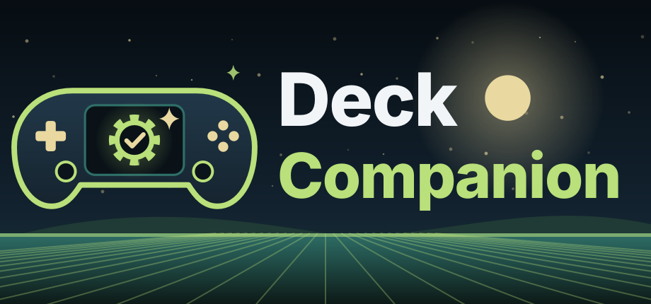
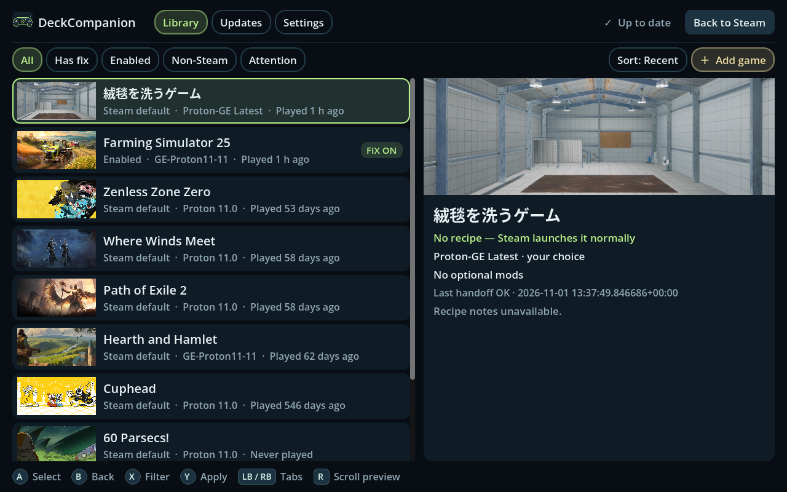
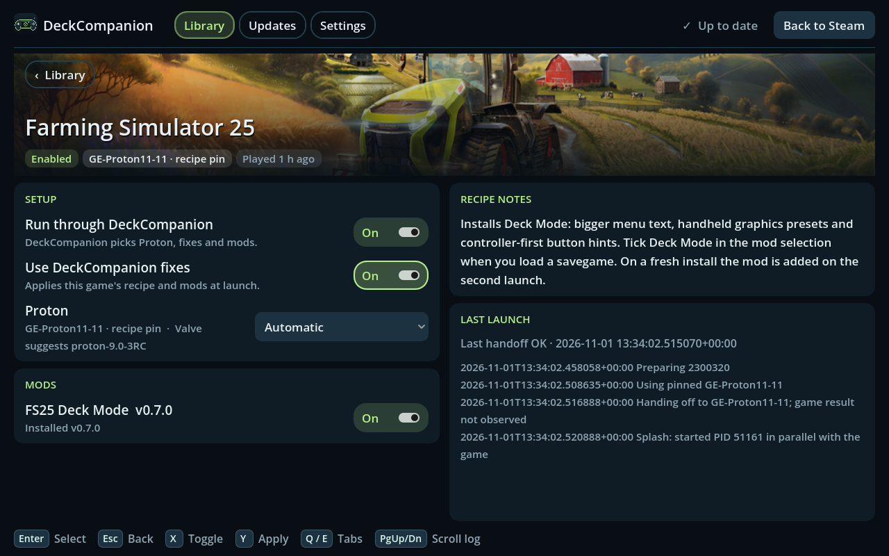
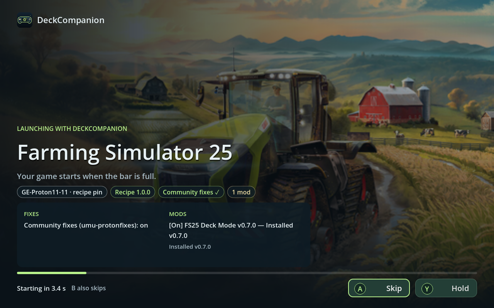

<p align="center">
  <a href="https://deckcompanion.renner.dev"></a>
</p>

<p align="center">
  <a href="https://github.com/rennerdo30/DeckCompanion/releases/latest"></a>
  <a href="https://github.com/rennerdo30/DeckCompanion/actions/workflows/ci.yml"></a>
  <a href="LICENSE"></a>
  <a href="https://deckcompanion.renner.dev"></a>
</p>

# DeckCompanion

**Fixes, mods and the right Proton for every Steam Deck game.** Website: <https://deckcompanion.renner.dev>

<p align="center">
  
  
  
</p>
<p align="center"><sub>Real screenshots from a Steam Deck: library, game page (Farming Simulator 25 with Deck Mode) and the launch splash.</sub></p>

DeckCompanion is a Steam compatibility tool plus a controller-first app in your Steam library:
- **Proton per game:** picks the right build for each game (recipe pin, your choice, GE-Proton when a community fix exists, Valve's recommendation).
- **Fixes and mods:** applies community and per-game fixes and installs mods.
- **Launch splash:** shows what runs at every launch.
- **Undo:** a snapshot of your Steam settings lets you restore everything with one button.

Install it once in Desktop Mode (Konsole):

```sh
curl -fsSL https://deckcompanion.renner.dev/install.sh | sh
```

Want to add a recipe or a fix for a game? See [CONTRIBUTING.md](CONTRIBUTING.md).

Technical: Python >= 3.11 (standard library only at runtime, vendored MIT `vdf` for Steam's formats), Godot 4.7 UI, target SteamOS 3.9. License: MIT.

## Non-Steam Windows games

In **Games → Add a game**, browse Home or a mounted drive, select an `.exe`,
keep or edit its prefilled name with the built-in controller keyboard, and choose
Standalone, Epic Games or GOG. Apply once to add its Steam library shortcut.
Non-Steam entries have a badge and a **Remove game** action; removal keeps the
original game files and save prefix. Store selection supplies compatibility fixes,
not store login, DRM bypass or a game downloader.

The shortcut runs the official umu-launcher zipapp as a separate process with the
best installed Proton (GE preferred). `update` tracks the newest upstream runtime (with an optional safety pin), or run
`deckcompanion umu install --json`. First launch may download umu's Steam runtime.
The GPL-3.0 runtime and its LICENSE are downloaded into the user's data directory;
no umu code is included in DeckCompanion's MIT source or release tarball.
See [non-Steam commands](docs/cli.md#non-steam-windows-games). **Not verified on hardware.**

## Decky Quick Access panel

The optional [Decky plugin](decky-plugin/README.md) shows the current or last game's
recipe, Proton and reason, mod states and last launch. It offers routing/mod toggles,
installed Proton choices, a global splash toggle and **Open DeckCompanion**.
Mapping changes stay queued until you Apply in the full app.

`deckcompanion decky status --json` checks Decky Loader and its latest stable release.
`deckcompanion decky install --json` supplies the official installer command and
opens it in Konsole when in Desktop Mode. The official installer handles its own
sudo prompt; DeckCompanion never asks for or stores passwords.

The plugin has its own version and `decky-v<version>` release, independent of the
engine. Use `deckcompanion decky plugin-status --json` and
`deckcompanion decky plugin-install --json` to discover and install/update it with
SHA256 verification from GitHub's asset digest. A user-writable `~/homebrew/plugins`
is required. If it is root-owned, use Decky's developer **Install Plugin from ZIP**
action with the separately released `deckcompanion-decky-<version>.zip`.
See [CLI details](docs/cli.md#decky-loader-and-independent-plugin).
**QAM rendering, controls and installer behavior need hardware checks.**

## Install (Desktop Mode)

Open Konsole on your Steam Deck and paste this one line:

```sh
curl -fsSL https://deckcompanion.renner.dev/install.sh | sh
```

The website serves the repository's bootstrap `install.sh`. It finds the newest stable `v<semver>` engine release through the GitHub API, verifies its SHA256 and installs it into your home folder.

Or download **DeckCompanion-Installer.desktop** from the
[newest engine `v*` release](https://github.com/rennerdo30/DeckCompanion/releases),
mark it executable if prompted, and double-click it. It opens Konsole and runs
the same installer, with download and execution timeouts.

The command, desktop launcher and standalone bootstrap use bounded, paginated
release discovery and select only stable `v<semver>` engine tags. Content and
Decky releases cannot redirect installation.

Steam can stay running. The installer downloads the newest engine release index and
engine, verifies SHA256, installs under `~/.local/share/deckcompanion/`, and
queues DeckCompanion as **Steam's default compatibility tool**. It then applies
the changes automatically, including from a pipe without a terminal prompt.
Steam restarts once if running and Steam-visible changes are queued. Engine-only
updates with unchanged mappings, shortcut and artwork need no restart.
No root, pacman, pip, services installed on disk,
or PATH changes are needed. Release assets must exist before these URLs work.

An engine-only release works without the UI. A release containing
`bin/deckcompanion-ui` adds a library shortcut, a stable icon and any supplied
Steam grid artwork. Installed engine version: `versions/0.3.2/`.

On Linux, applying while Steam runs submits a detached helper and returns
`scheduled: true` immediately. The helper waits up to 120 seconds for Steam to
close, writes queued changes with backups, then restores Game Mode or Desktop
Steam. Scheduling does not confirm success; check:

```sh
~/.local/share/deckcompanion/bin/deckcompanion status --json
```

The `last_apply` field contains the helper result. With Steam closed, apply
writes immediately. See the [CLI contract](docs/cli.md). Device behavior is
**not verified on hardware**.

To uninstall, close Steam, then run:

```sh
~/.local/share/deckcompanion/bin/deckcompanion uninstall --json
```

This restores the previous default and game mappings while DeckCompanion is
still selected, removes its shortcut and artwork, and preserves user-modified
files, saves and downloaded Proton builds. See [Uninstall](#uninstall) below.

## How it works

- Recipes select pinned GE-Proton, environment, Wine fixes, mods and initial settings.
  Games without recipes prefer an installed GE/UMU build containing their community
  fix, then Valve's local recommendation, then the newest installed Proton by version;
  GE wins equal versions. Experimental ranks half a major above the newest installed
  Valve major. Aliases resolve once; non-Proton tools are excluded.
- Engine preparation errors log a warning and launch the selected or newest Proton
  with original arguments. Only absence of any usable Proton prevents handoff.
- Cached recipes/assets work offline. Launch never downloads Proton; an unavailable
  pin falls back to installed Proton. Optional mod downloads retain their two-second budget.
- Updates install GE-Proton pinned by enabled recipes plus the newest GE by default.
  The Updates tab shows wanted builds, Install/retry, progress and disk use. Downloads
  run as detached user services so closing the UI does not stop them. Settings offers
  `auto_install_ge` and `cleanup_old_ge` (both on by default). Cleanup keeps recipe pins,
  newest GE, external builds and locally modified installs, and waits while Steam runs.
  CLI: `deckcompanion proton --json` and `deckcompanion proton install GE-Proton11-11 --json`.
- Managed protonfixes localfixes chain the bundled upstream fix first. User localfixes
  are preserved. Wine installs/registry steps run once per prefix.
- SHA256 and manifests track mods. FS25 Deck Mode stays zipped in FS25's mods folder.
  Enable, install and mod toggles reconcile immediately when the prefix exists and
  the game is closed. Identical hand-installed files are adopted; different or
  user-modified files are preserved and reported as blocked.
- Content waits until launch if Proton has not created `pfx` or the game is running.
  The CLI reports installed, deferred, update, off and blocked mod states. Initial settings
  use per-prefix stamps and never overwrite later changes.
- Recipe selection prefers the newer recipe version, then the publishing/bundling
  engine version; install refreshes stale recipe cache entries.
- Game JSON includes existing local Steam artwork paths and the installed Proton
  selection for the preview panel, with no network requests.
- Steam mappings, shortcuts and grid images change only with Steam closed, with backups.
  Queue enable/disable or `default --on|--off`, then apply. No CEF or remote debugging.
- `update` installs verified releases and atomically switches `current`; `rollback`
  selects the previous engine. No launch-time Git operations remain.

Everything lives under your home directory, surviving SteamOS system updates.
All roots can be overridden for tests. See [CLI contract](docs/cli.md),
[recipes](docs/recipes.md), and [updates/signing design](docs/updates.md).

## How fixes work

Known games automatically get their bundled community fix: after user Proton
choices and installed recipe pins, DeckCompanion picks the newest installed GE-Proton/UMU-Proton
that contains that game's `protonfixes/gamefixes-steam/<appid>.py` (or
`gamefixes-umu/<umu-id>.py`). Discovery works offline and caches build paths and
directory timestamps; `default.py` is not a per-game fix. The independent content
channel can also carry fix IDs before GE is installed. If only that index knows
the fix, Valve's choice stays selected and game JSON reports
`community_fix: "available_not_installed"`. Installing a matching GE build makes it
eligible on the next query/launch. `settings --set prefer_community_fixes=off`
turns off automatic preference; usable user overrides win over recipe pins too.
A recipe whose exact pin is missing falls back within installed GE/UMU builds,
preferring one containing its community fix, rather than using Valve's recommendation.
No runtime
download or upstream request is added to launch. Game and splash JSON report the
fix status and selected build name; actual upstream execution needs a launch check.

GE-Proton supplies upstream protonfixes. For a recipe-managed app, DeckCompanion
generates `~/.config/protonfixes/localfixes/<appid>.py`, forwarding upstream's
early/main hooks first, then applying the DeckCompanion recipe steps. Wine
installs and registry steps run once per prefix and recipe revision, retrying
after failure; DLL overrides and environment settings apply on each launch.
Foreign localfixes are preserved. Mods and initial settings are handled by the
engine when the prefix exists, separately from the Wine hooks.

Generic Wine fixes should be contributed to
[umu-protonfixes](https://github.com/Open-Wine-Components/umu-protonfixes), with
an appid, reproducible problem, minimal fix and Proton launch evidence. Recipes
retain mod delivery and user choices. Our pinned development submodule tests the
real upstream loader without shipping another copy. See
[pin, tests and contribution details](docs/protonfixes.md). Runtime behavior
remains **not verified on hardware**.

## Migration from the 2022 prototype

The root `DeckCompanion` and `toolmanifest.vdf` command path remain. Old git-clone
installs receiving this revision use a migration shim on their next invocation:
it executes the installed engine, or falls back to installed Proton while logging
how to run `install.sh`. No old scripts or self-updates run in the shim. Install
while Steam runs if desired, then apply queued Steam changes. The installer preserves the clone's Git metadata and tracked
compatibility launcher, rather than deleting or overwriting that checkout.

An already-running old launcher may finish its old code after its last `git pull`;
restart the game to enter the shim. 602520/2087030 retain useful historical Wine
verbs; 1063730's missing `fix-eac.sh` was dropped.

## Uninstall

Close Steam and run `sh uninstall.sh` from a release/checkout, or
`~/.local/share/deckcompanion/bin/deckcompanion uninstall --json`. This restores
prior default and per-game compatibility mappings when ours is selected, removes our shortcut/artwork/localfixes
and unmodified installed files, and removes unchanged manifest-owned mods.
Modified files are listed and preserved. State, cache, manifests, logs and Steam
backups remain for recovery; an old clone is preserved. Prefixes, saves, games,
downloaded Proton runtimes and unrelated shortcuts are never removed.

## Development and local releases

Set `PYTHONPATH=src` and use `python3 -m deckcompanion`. Pytest is dev-only:
`python3 -m pytest -q tests`. Tests use temporary trees, fake archives and mocked
network/process calls. No Steam or remote device needed.
For upstream-loader coverage in development or CI, first run
`git submodule update --init third_party/umu-protonfixes` (never recursive).
Without it, those tests skip cleanly. Release builds do not need the submodule
and always exclude `third_party/` and its separately licensed nested dependencies.
`python3 scripts/build_release.py --output dist` resolves API metadata and produces
engine/index/checksums and installer assets locally; nothing publishes.
`--offline` produces a development bundle with unresolved source mods (not installable
until a resolved index is fetched). Optional exported UI input: `bin/deckcompanion-ui`;
the release builder also includes `assets/logo/` and `assets/steam/` when present. The parent supplies
the PNG icon; no image conversion is performed by the engine.

## Tested on hardware

Tested on a Steam Deck (SteamOS 3.9) in Game Mode and Desktop Mode: install while
Steam runs, Apply with a Steam restart, "all games" takeover and Restore all, Valve
recommendations, GE-Proton install, FS25 Deck Mode adoption, existing shortcuts,
the launch splash and the in-app Decky install with the Steam keyboard.
Game and mod behaviour still depends on each recipe. `last_launch.ok` records
preparation, not game success. SHA256 trusts the HTTPS index; publisher signature
verification is designed but not implemented.

DeckCompanion has no telemetry and never uploads anything. It never needs `sudo`,
with one exception: installing or updating Decky Loader. That asks for your Deck
password inside the app. The password goes only to `sudo`, is read once from a
RAM-only file that is deleted immediately, and is never stored or logged.

## Credits

DeckCompanion stands on the work of these projects. Thank you!

| Project | What DeckCompanion uses it for | License |
| --- | --- | --- |
| [umu-launcher](https://github.com/Open-Wine-Components/umu-launcher) (Open Wine Components) | Runs non-Steam games and store launchers; downloaded at runtime as a separate program | GPL-3.0 |
| [umu-protonfixes](https://github.com/Open-Wine-Components/umu-protonfixes) (Open Wine Components) | Community game fixes, run by GE-Proton; generated local fixes build on its API | BSD-2-Clause |
| [umu-database](https://github.com/Open-Wine-Components/umu-database) | Game ID lookup for non-Steam games; the CSV is downloaded at runtime | GPL-3.0 |
| [GE-Proton](https://github.com/GloriousEggroll/proton-ge-custom) (GloriousEggroll) | The Proton build for recipes and community fixes; downloaded at runtime | per component (see project) |
| [Proton](https://github.com/ValveSoftware/Proton) and Steam (Valve) | Compatibility tools, Steam Deck compatibility recommendations | per component (see project) |
| [ValvePython vdf](https://github.com/ValvePython/vdf) | Reads and writes Steam's VDF files (vendored in `vdf/`) | MIT |
| [Godot Engine](https://godotengine.org) | The management app and launch splash | MIT |
| [Decky Loader](https://github.com/SteamDeckHomebrew/decky-loader) and [decky-installer](https://github.com/SteamDeckHomebrew/decky-installer) (Steam Deck Homebrew) | Optional Quick Access plugin; the official installer is used unchanged | GPL-2.0 |
| [@decky/ui](https://github.com/SteamDeckHomebrew/decky-frontend-lib), [@decky/api](https://github.com/SteamDeckHomebrew/loader-api), @decky/rollup | Building the Decky plugin | LGPL-2.1 (ui, api), BSD-3-Clause (rollup) |
| [Inter](https://github.com/rsms/inter) (Rasmus Andersson) | Lettering in the logo and Steam artwork, converted to outlines | OFL-1.1 |

Full license texts and details are in [THIRD_PARTY_NOTICES.md](THIRD_PARTY_NOTICES.md).
DeckCompanion itself is MIT. Steam and Steam Deck are trademarks of Valve Corporation;
DeckCompanion is not affiliated with or endorsed by Valve.
